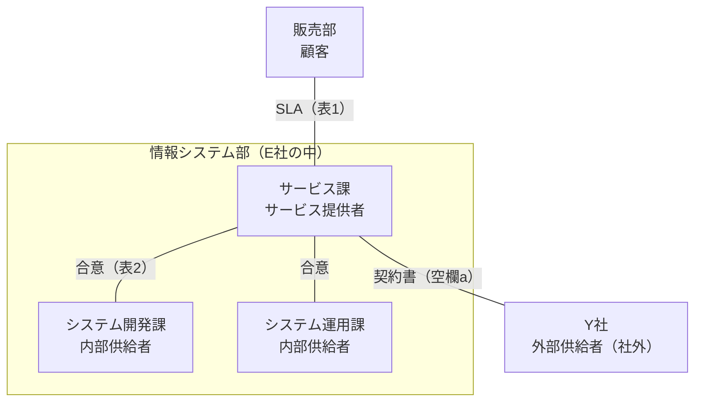

# サービスマネジメントの登場人物と関係

令和5年度秋期 問10の復習で整理した内容です。サービスマネジメントの問題では、毎回この関係を読み取ることが土台になります。

## 一言でいうと

サービス課が元請けとして販売部とSLAを結び、社内の下請け（システム開発課・システム運用課）と社外のパートナー（Y社）とも目標をそろえている、という構図です。

## 役割の名前と実際の名前

問題文は、普段は実際の部署名で書き、ルールを説明する場面だけ役割の名前で書きます。どちらも同じ相手を指します。

| 役割の名前 | 令和5年度秋期 問10では | 結ぶ取り決め |
|---|---|---|
| 顧客 | 販売部（サービスを使う側） | SLA（サービス提供者との合意） |
| サービス提供者 | サービス課（元請け） | 顧客にSLAを約束する |
| 外部供給者 | Y社（サービスデスクを担うコールセンター会社） | 契約書（法的な拘束力がある） |
| 内部供給者 | システム開発課、システム運用課（社内の下請け） | 合意文書（社内の約束、OLA） |

## 関係図

## 設問とのつながり

| 設問 | 聞かれていること |
|---|---|
| 2(1) | Y社は社外なので、交わす文書は「契約書」 |
| 2(2) | 販売部とのSLA（表1）を守るには、作業を担う社内部署とも目標を合意する必要がある |
| 2(3) | 表1の復旧目標には開発課以外の作業時間も含まれるので、開発課の「8時間以内」は見直しが必要 |
| 3(1) | Y社は事前の件数で要員を確保するため、問合せが想定より増えると体制が足りなくなる |
| 3(2) | FAQは24時間見られる社内Webに載せるので、受付時間外でも利用者が自分で解決できる |

## 次に解くときのコツ

1. 最初の5分で、上の形の関係図をメモに描いてから設問に進む。
2. 下線の理由を問われたら、主語と相手を確認する。
3. 理由は「顧客と約束したSLAを守るため」につなげ、SLAに影響する結果まで書く。
